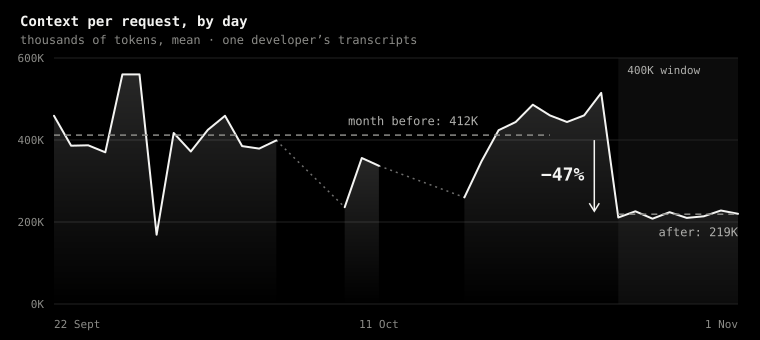

# The numbers

What tokendoctor did on its author's six weeks of real Claude Code use, and on the benchmark in the repository: where "up to 38% less" comes from, and why yours may differ.

## Six weeks of real use

One developer's transcripts, 22 September to 1 November, read from the local files with benchmark and temporary folders left out. On 25 October the compaction window went from Claude Code's 1M to 400K, and subagents went to Sonnet. Days are UTC days; costs are at each model's API list price, main thread.

| Result | What was measured |
| --- | --- |
| **−38%** | Main-thread cost per request at API list prices: the month before against the week after |
| **412K → 219K** | Context per request (−47%) |
| **−33%** | The same sessions replayed at a 400K window, nothing else changed: −33% of the main thread, −20% of all spend |
| **−19% cost, −33% time** | The slide against a summary, the same day of work ([bench](https://github.com/localixai/tokendoctor/blob/main/bench/README.md)) |
| **−11 to −21% cost** | A week of work in [bench](https://github.com/localixai/tokendoctor/blob/main/bench/README.md) (27 steps), Claude Code as it ships against every fix applied and the slide; all tests pass |

The week of work is the median of 2 and 3 runs; single runs went from −40% to +17%. Measured again on 4 November for 0.5.1, when costs moved to API list prices; the [changelog](https://github.com/localixai/tokendoctor/blob/main/CHANGELOG.md) says what changed.

## Context per request, by day

Each period's mean is over all its requests, not the mean of its days. Days under 50 requests are left out.

| Day | Context per request | Requests |
| --- | --- | --- |
| 22 Sept | 459K | 766 |
| 23 Sept | 386K | 357 |
| 24 Sept | 387K | 1,413 |
| 25 Sept | 370K | 1,194 |
| 26 Sept | 560K | 833 |
| 27 Sept | 560K | 821 |
| 28 Sept | 169K | 305 |
| 29 Sept | 417K | 1,160 |
| 30 Sept | 372K | 1,025 |
| 1 Oct | 425K | 1,225 |
| 2 Oct | 459K | 653 |
| 3 Oct | 385K | 1,319 |
| 4 Oct | 379K | 1,568 |
| 5 Oct | 399K | 744 |
| 9 Oct | 236K | 146 |
| 10 Oct | 356K | 608 |
| 11 Oct | 337K | 1,039 |
| 16 Oct | 260K | 630 |
| 17 Oct | 348K | 684 |
| 18 Oct | 424K | 2,706 |
| 19 Oct | 444K | 1,276 |
| 20 Oct | 486K | 1,622 |
| 21 Oct | 460K | 1,394 |
| 22 Oct | 444K | 2,177 |
| 23 Oct | 460K | 2,430 |
| 24 Oct | 515K | 743 |
| 25 Oct, 400K window | 211K | 3,284 |
| 26 Oct | 226K | 2,264 |
| 27 Oct | 208K | 1,948 |
| 28 Oct | 224K | 3,173 |
| 29 Oct | 210K | 1,779 |
| 30 Oct | 214K | 318 |
| 31 Oct | 228K | 3,213 |
| 1 Nov | 220K | 3,292 |

## Slide against summary

On the benchmark's day of work (Haiku 5.5, a 100K window): a slide takes under a second where a summary waits 103 to 137 s, the same work costs 19% less and takes 33% less time, and every test passes. In the author's own sessions a summary takes 79 s on average. [The slide](slide.md#slide-against-summary) has every run.

## No one pill

- If your sessions rarely pass 400K tokens, the window won't help.
- A summary that lands just before you finish can cost more than it saves.
- Your models, effort and the work itself move the number.
- On a Team or Enterprise login, the slide needs one `sudo` install.

So tokendoctor shows you yours first: `/tokendoctor:sessions` replays your own sessions at smaller windows before anything changes. See [Your sessions](sessions.md).
