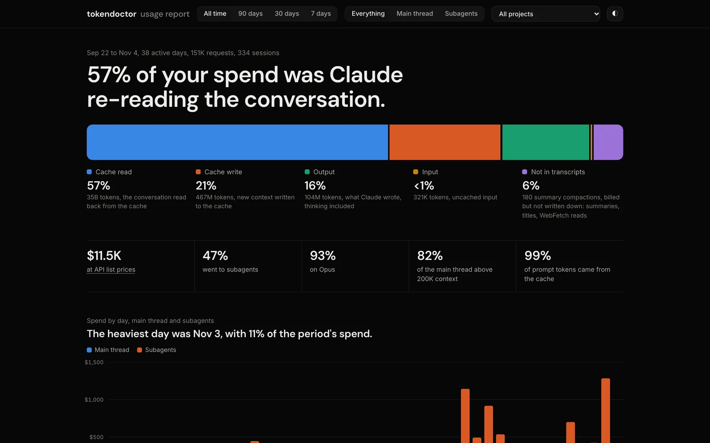

# Your sessions

What your own Claude Code use overpays, measured from the transcripts on this machine: the replay at smaller windows, the session report and its findings, the dashboard and the daily trend. All of it is read-only.

## The replay

`/tokendoctor:sessions [days]` opens with your own number: your sessions of the last 30 days (or `days`) replayed as if Claude Code had compacted at a smaller window, and the share of all cost each window would have saved. From a shell it is `tokendoctor-replay`:

```sh
$ tokendoctor-replay --days 45
334 sessions in the last 45 days. Had Claude Code compacted at a smaller window:
   200K   15.5% of all cost saved  (111 sessions affected, 861 compactions more)
   300K   14.7% of all cost saved  (88 sessions affected, 364 compactions more)
   400K   11.1% of all cost saved  (69 sessions affected, 175 compactions more)
   600K    7.3% of all cost saved  (41 sessions affected, 61 compactions more)
An estimate: it cannot see the work a model does again after a summary.
```

That is the author's own history. Take it as an upper bound: the replay cannot see the work a model does again after a summary. If your window is already at or under 400K, or almost no session passes it, a smaller window changes little for you.

`--window 200k,400k` picks the windows, `--json` prints the figures as JSON.

## Where the tokens went

After the replay, the report leads with the largest shares: main thread against subagents, the share spent with more than 400K tokens in context, the subagent types that cost the most, and cache rebuilds. Then its findings:

| Finding | Severity | What it catches |
| --- | --- | --- |
| `late-compaction` | warn | Over 30% of main-thread cost spent with more than 400K tokens in context. |
| `subagents-on-top-model` | warn | Subagents on Opus or Fable making over 5% of all cost. Forks always run on the main model. |
| `long-sessions` | info | Sessions of 500+ turns, with their share of cost. |
| `idle-cache-rebuilds` | info | The prompt cache rebuilt after it expired during a break. |
| `images-read-repeatedly` | info | The same image read three or more times. |
| `rereads-after-compaction` | info | Files read before a summary and read again within the next 10 requests: what the summary lost. Shown against slides when there are some. |

A finding points to the setting that answers it (`late-compaction` to `autoCompactWindow`, `subagents-on-top-model` to `CLAUDE_CODE_SUBAGENT_MODEL`), and [the audit](audit.md) checks and fixes them.

## The dashboard

`/tokendoctor:dashboard [days]` builds and opens a local dashboard of every session on this machine: spend by day, kind of token, model, reasoning effort, main thread and each subagent type, context size, project and hour, with filters. It is one HTML file and uses no network. It leads with what most of the spend was: on the author's history, 57% of it was Claude re-reading the conversation.



The file holds project names and session ids, so it stays on this machine. From a shell: `tokendoctor-dashboard [--days n] [--open]`.

## The trend

`tokendoctor-sessions --by day` (or `--by week`) shows the trend. The plugin's one hook appends each finished day's totals to `~/.claude/tokendoctor/history.jsonl` when a session starts, so the trend outlives Claude Code's transcript cleanup.

## What is counted

Costs are dollars at each model's Claude API list price. On a Pro or Max plan that is what the same work would cost on the API, not what it took from the plan's limits. Requests Claude Code bills but does not write into transcripts (a summary compaction's own request, titles, WebFetch page reads) are counted from its own session totals where they hold, else estimated. [Limits](limits.md) has the details.

The transcripts are read for usage figures, timestamps, tool names and file paths, never message text.
